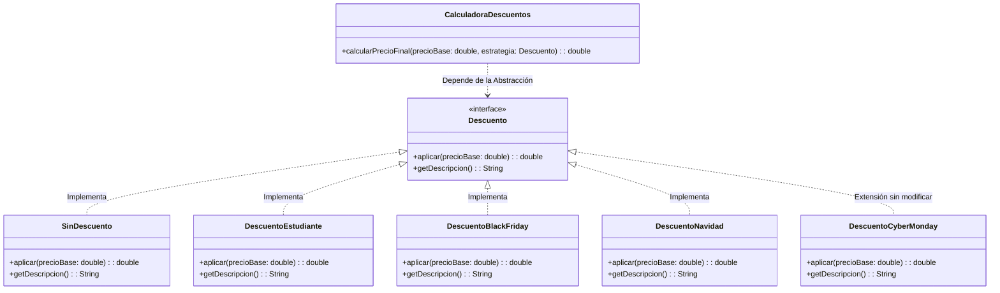

# Principio Abierto / Cerrado (Open / Closed Principle - OCP) 🛡️
> **La "O" de los Principios SOLID de Diseño de Software**

---

## 👥 Información Académica y del Equipo
* **Asignatura:** Programación II
* **Tema Asignado:** Principio Abierto / Cerrado (OCP)
* **Grupo:** Grupo 2
* **Integrantes:**
  * Santiago Palma
  * Johan Gonzalez
  * Heidy Valentina
* **Fecha de Entrega y Exposición:** 27 de Noviembre

---

## 🎯 ¿Qué es el Principio Abierto/Cerrado?

Formulado originalmente por **Bertrand Meyer** en 1988 y redefinido por **Robert C. Martin (Uncle Bob)** en la década de los 90, el principio establece:

> *"Las entidades de software (clases, módulos, funciones) deben estar **abiertas para su extensión**, pero **cerradas para su modificación**."*

* **Abierto para su extensión:** El sistema debe permitir incorporar nuevas funcionalidades o comportamientos cuando el negocio lo requiera.
* **Cerrado para su modificación:** La incorporación de esas nuevas características **no debe exigir alterar el código fuente ya existente, probado y en producción**.

### 💡 Analogía de la vida real
Una computadora no necesita que abras su gabinete ni que sueldes cables en la placa madre cada vez que conectas un mouse o un teclado nuevo: la placa madre ofrece una interfaz estable (**puerto USB**). El puerto USB está **cerrado a modificación**, pero **abierto a la extensión** de cualquier dispositivo periférico que implemente el estándar.

---

## ⚖️ Dos interpretaciones históricas

| Criterio | 1. Enfoque de Bertrand Meyer (1988) | 2. Enfoque Polimórfico de Robert C. Martin (1996) |
| :--- | :--- | :--- |
| **Mecanismo base** | **Herencia clásica de clases concretas** | **Interfaces y Polimorfismo** |
| **Cómo se extiende** | Creando subclases que heredan estado y comportamiento | Creando nuevas clases que implementan un contrato abstracto |
| **Nivel de acoplamiento** | Alto (las subclases dependen fuertemente de la clase padre) | Bajo (desacoplamiento total mediante abstracciones) |
| **Uso en la industria actual** | Considerado restrictivo y frágil en arquitecturas grandes | **Estándar universal de Clean Architecture y SOLID** |

---

## 📁 Estructura del Proyecto

El proyecto está organizado en dos paquetes para contrastar claramente el antes y el después:

```text
├── src/
│   ├── sin_ocp/                         # ❌ Código con Anti-patrón (Violación de OCP)
│   │   ├── CalculadoraDescuentos.java   # Contiene condicionales crecientes (if/else if)
│   │   └── MainSinOcp.java              # Demostración del problema
│   │
│   └── con_ocp/                         # ✔️ Código Refactorizado (Cumpliendo OCP)
│       ├── Descuento.java               # Contrato abstracto invariable (Interfaz)
│       ├── SinDescuento.java            # Implementación concreta (0%)
│       ├── DescuentoEstudiante.java     # Implementación concreta (10%)
│       ├── DescuentoBlackFriday.java    # Implementación concreta (30%)
│       ├── DescuentoNavidad.java        # Implementación concreta (20%)
│       ├── DescuentoCyberMonday.java    # 🌟 Nueva extensión sin tocar el núcleo
│       ├── CalculadoraDescuentos.java   # Clase cerrada a modificación
│       └── MainConOcp.java              # Demostración polimórfica ejecutable
│
├── presentacion.html                    # Diapositivas interactivas listas para proyector
├── Principio_Abierto_Cerrado_OCP.pptx    # Presentación en formato PowerPoint / Canva
└── README.md                            # Documentación técnica completa
```

---

## ❌ 1. El Problema: Violación de OCP (`sin_ocp`)

En este paquete, el cálculo de descuentos se resuelve mediante una cadena de condicionales `if - else if`:

```java
// Ubicación: src/sin_ocp/CalculadoraDescuentos.java
public double calcularPrecioFinal(double precioBase, String tipoDescuento) {
    if (tipoDescuento.equalsIgnoreCase("NINGUNO")) {
        return precioBase;
    } else if (tipoDescuento.equalsIgnoreCase("ESTUDIANTE")) {
        return precioBase * 0.90;
    } else if (tipoDescuento.equalsIgnoreCase("BLACK_FRIDAY")) {
        return precioBase * 0.70;
    } else if (tipoDescuento.equalsIgnoreCase("NAVIDAD")) {
        return precioBase * 0.80;
    }
    // ❌ CADA NUEVA CAMPAÑA COMERCIAL OBLIGA A REABRIR Y MODIFICAR ESTA CLASE
    throw new IllegalArgumentException("Tipo no reconocido");
}
```

### ¿Por qué es un mal diseño?
1. **Fragilidad (Efectos colaterales):** Modificar código en producción para agregar una campaña puede introducir accidentalmente un error que dañe las promociones previas.
2. **Re-certificación costosa:** Cada cambio obliga a volver a probar exhaustivamente toda la clase `CalculadoraDescuentos`.
3. **Violación de SRP (Single Responsibility):** La calculadora acumula conocimientos de todas las fórmulas comerciales del negocio.

---

## ✔️ 2. La Solución: Cumpliendo OCP (`con_ocp`)

Aplicando el **Patrón Strategy** y **Polimorfismo**, blindamos la lógica de negocio:

### 1. El Contrato Abstracto Estable
```java
// Ubicación: src/con_ocp/Descuento.java
public interface Descuento {
    double aplicar(double precioBase);
    String getDescripcion();
}
```

### 2. La Clase Cliente Blindada (Cerrada a Modificación)
```java
// Ubicación: src/con_ocp/CalculadoraDescuentos.java
public class CalculadoraDescuentos {
    public double calcularPrecioFinal(double precioBase, Descuento estrategiaDescuento) {
        // Despacho polimórfico dinámico: la clase no sabe ni le importa
        // cuál es el descuento concreto, solo delega al contrato.
        return estrategiaDescuento.aplicar(precioBase);
    }
}
```

### 3. Extensión sin Modificación
Para añadir la promoción **Cyber Monday (25%)**, simplemente creamos un archivo nuevo:

```java
// Ubicación: src/con_ocp/DescuentoCyberMonday.java
public class DescuentoCyberMonday implements Descuento {
    @Override
    public double aplicar(double precioBase) {
        return precioBase * 0.75;
    }

    @Override
    public String getDescripcion() {
        return "Campaña Cyber Monday (25%)";
    }
}
```
**Resultado:** `CalculadoraDescuentos` nunca se enteró ni sufrió una sola modificación. El sistema creció limpiamente.

---

## 📊 Diagrama de Clases UML (Mermaid)



---

## 🚀 Instrucciones de Compilación y Ejecución

Puedes clonar el repositorio y correrlo directamente desde la terminal con Java:

### 1. Compilar todo el código:
```bash
javac -d bin src/sin_ocp/*.java src/con_ocp/*.java
```

### 2. Ejecutar el caso SIN OCP (Violación):
```bash
java -cp bin sin_ocp.MainSinOcp
```

### 3. Ejecutar el caso CON OCP (Refactorizado):
```bash
java -cp bin con_ocp.MainConOcp
```

---

## 🔗 Relación con los demás Principios SOLID y Límites (YAGNI)

* **Relación con DIP (Dependency Inversion):** La letra **D** es el habilitador técnico de la **O**: para que una clase esté cerrada a modificación, sus dependencias deben ser interfaces o abstracciones, nunca clases concretas instanciadas con `new`.
* **Relación con LSP (Liskov Substitution):** Cualquier nueva implementación de `Descuento` debe ser 100% sustituible sin romper el comportamiento esperado por `CalculadoraDescuentos`.
* **¿Cuándo NO aplicar OCP? (Principio YAGNI - *You Aren't Gonna Need It*):**  
  Intentar cerrar todas las clases del sistema de antemano es **sobreingeniería**. Solo se debe aplicar OCP cuando las variaciones de negocio sean **reales y frecuentes**. Si algo cambia una sola vez, una abstracción prematura solo añade complejidad innecesaria.

---

## 📚 Referencias Bibliográficas

1. **Meyer, B. (1988).** *Object-Oriented Software Construction*. Prentice Hall. ISBN 0-13-629049-3.
2. **Martin, R. C. (1996).** *The Open-Closed Principle*. The C++ Report, Enero 1996.
3. **Martin, R. C. (2000).** *Design Principles and Design Patterns*. Object Mentor Technical Paper.
4. **Larman, C. (2001).** *Protected Variation: The Importance of Being Closed*. IEEE Software, 18(3), 89–91.
5. **Gamma, E., Helm, R., Johnson, R., & Vlissides, J. (1994).** *Design Patterns: Elements of Reusable Object-Oriented Software*. Addison-Wesley.
"# Abierto-o-Cerrado" 
